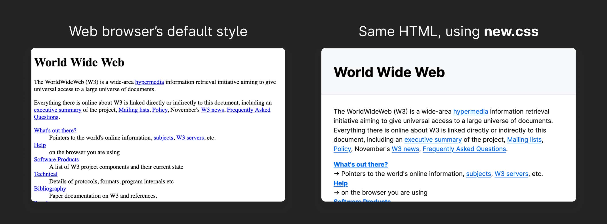

# new.css

**new.css** is a lightweight stylesheet for turning basic HTML into modern, nice-looking websites.

Most CSS frameworks provide classes like `.btn` or `.header`. **You don't need any classes for new.css**; it extends your browser's built-in styles for elements like `<button>` and `<header>`.

new.css is great for...

- ...building a super-simple blog or "about me" site
- ...rendering HTML generated from Markdown
- ...a sensible starting point to extend into a more complex stylesheet

Here's a real example:



## Table of Contents

- [Usage](#usage)
    - [Demo](#demo)
    - [Alternative `@import` Installation](#alternative-import-installation)
    - [Local Installation](#local-installation)
- [FAQs](#faqs)
- [Themes](#themes)
- [Special Thanks](#special-thanks)
- [Support](#support)

## Usage

Add these lines to your site's `<head>` section:

```html
<link rel="preconnect" href="https://newcss.net">
<link rel="stylesheet" href="https://newcss.net/v1/new.css">
```

If you'd like the font [Inter](https://rsms.me/inter) as well (recommended), add this line as well:

```html
<link rel="stylesheet" href="https://newcss.net/font/inter.css">
```

### Demo

A simple demo site showing how to use these links is available at [this CodePen](https://codepen.io/editor/bdndev/pen/01a1c758-9e9e-7e2e-becb-7ec16bf9dd62?tab=%2Findex.html&orientation=left&panel=blocks&show=split).

### Alternative `@import` Installation

If you're not able to edit your site's HTML, you can alternatively add these lines to the very beginning of your stylesheet. These *must* be the first lines of your stylesheet in order to work; you can [read more about `@import` rules here](https://developer.mozilla.org/en-US/docs/Web/CSS/Reference/At-rules/@import#description).

```css
@import url("https://newcss.net/v1/new.css");
@import url("https://newcss.net/font/inter.css");
```

### Local Installation

new.css is a very small file, about 4.8 kilobytes minimized. You can download `new.min.css` from this repository and add it to your own website, then add a `<link rel="stylesheet" href="path/to/new.min.css">` link in your site's `<head>` pointing to the file.

If you're keeping everything contained in one HTML file, you can even copy the contents of `new.min.css` into a `<style>...</style>` element.

## FAQs

- *Why should I use this instead of Bootstrap, Tailwind, or [any other popular framework]?*
  - new.css wasn't made to be a "true" CSS framework, but rather a tool for rapidly prototyping raw HTML or creating simple sites where the flexibility of a fully-fledged framework might act as an inhibitor to making progress. 
  
    If you need something more complex and don't want to write your own classes, another framework might be the right choice for you!
- *Who is this meant for?*
  - Currently, I'm building this with moderately experienced web developers in mind: those who already know how to write semantic HTML, host their own site, and read the CSS file to answer basic questions. Creating more beginner-friendly documentation is on the roadmap.
- *Is it correct to call this a framework?*
  - ¯\\\_(ツ)\_/¯

## Themes

new.css uses [CSS variables](https://developer.mozilla.org/en-US/docs/Web/CSS/Guides/Cascading_variables/Using_custom_properties) for defining colors and fonts, making them easy to modify.

> **NOTE:** In hindsight, these variables were poorly named and are confusing to use. I haven't changed their names to prevent breaking existing sites. When a future version 2 of new.css is released, it will certainly contain more descriptive and useful variables. :\)

Here are the current variables and their uses:

- `--nc-font-sans`: font family used for headers and body text
- `--nc-font-mono`: font family used for inline code and code blocks
- `--nc-tx-1`: color for text headers `<h1>` through `<h6>`
- `--nc-tx-2`: color for body text
- `--nc-bg-1`: background color for the whole page
- `--nc-bg-2`: accent color used for `<header>`, blockquotes, code blocks, and the underlines for text headers
- `--nc-bg-3`: accent border color for `<header>`, blockquotes, code blocks, and other elements
- `--nc-lk-1`: color for links
- `--nc-lk-2`: color for links, when hovered
- `--nc-lk-tx`: color for `<button>` text
- `--nc-ac-1`: background color for currently selected text and the `<mark>` element
- `--nc-ac-tx`: text color for currently selected text and the `<mark>` element

Here's an example of a stylesheet to change header backgrounds to light pink in light mode, and a darker purple in dark mode:

```css
:root {
  --nc-bg-2: #fbcfe8;
}

@media (prefers-color-scheme: dark) {
  :root {
    --nc-bg-2: #1e1b4b;
  }
}
```

## Special Thanks
- [sakura.css](https://github.com/oxalorg/sakura) by [oxal](https://github.com/oxalorg) for introducing me to classless CSS
- [mydarkstar](https://mydarkstar.net/) for priceless advice during development

## Support

If you have questions or feedback you'd like to share directly, you're welcome to email me at `contact at bdn dot sh`!